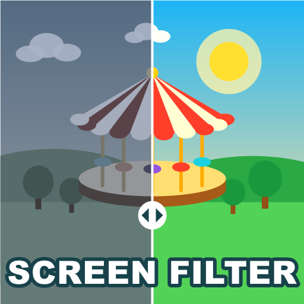

# Screen Filter

A [Parkitect](https://www.themeparkitect.com/) mod that adds a **Custom** color filter you can tune while looking at your park, plus camera effects for a less clean, more photographic look.

[Steam Workshop page](https://steamcommunity.com/sharedfiles/filedetails/?id=3832726188)



## Color filter

Brightness, contrast, saturation, gamma, temperature and tint, starting from one of the game's own filters if you like.

## Effects

These work with or without the color filter, and **Use these effects** turns them all off or on at once.

- Vignette and its softness: darker or lighter than the game's own vignette, or removed altogether
- Film grain and its size
- Chromatic aberration
- Bloom strength and threshold, on top of the game's own values

At their default values, the effects leave the game's image exactly as it was.

## How to use it

- Open a park and press **J** to open the window. The key can be changed in the game's controls settings.
- Tick **Use this filter** and move the sliders. The image changes as you drag.
- Close the window with **J**, **Esc** or its **X** button. Your values are saved.
- **Reset** puts every slider back to its default.

The same controls are also in the mod's settings, and Custom is listed with the other filters in the graphics options. It only changes the image of the park, and only on your own screen, so other players in a multiplayer game don't need it.

## Building

You need the .NET SDK and Parkitect installed.

```bash
dotnet build -c Release
```

The build copies the mod and the preview into `Documents/Parkitect/Mods/screen_filter`. If the game or the mods folder is somewhere else:

```bash
dotnet build -c Release -p:ParkitectManaged="<Parkitect>/Parkitect_Data/Managed" -p:ModOutputDir="<mods folder>/screen_filter"
```

## Code

| File | What it does |
| --- | --- |
| `src/screen_filter_mod.cs` | Entry point, key and settings UI |
| `src/lut_builder.cs` | Builds the color lookup table the game's Lutify effect applies for the Custom filter |
| `src/post_effects.cs` | Vignette, grain, chromatic aberration and bloom, adjusted on the game's post processing profile |
| `src/filter_window.cs` | The in-game window |
| `src/filter_settings.cs` | Settings |

## License

[MIT](LICENSE)
